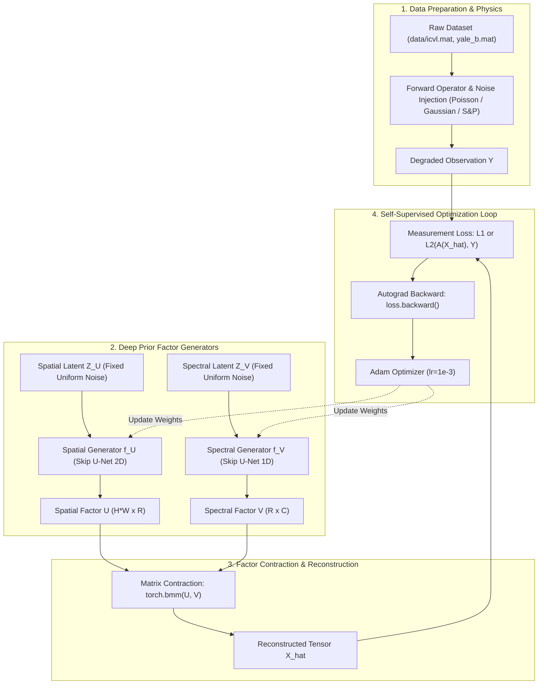
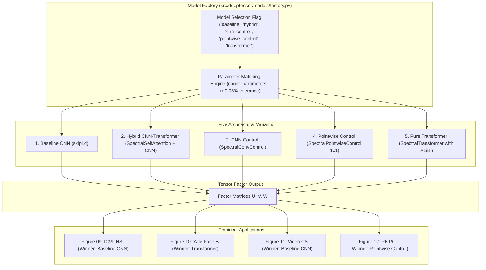
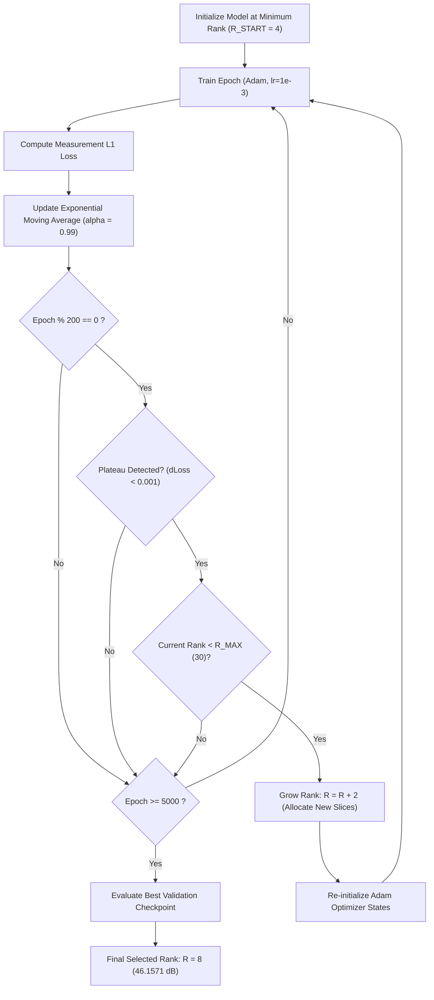
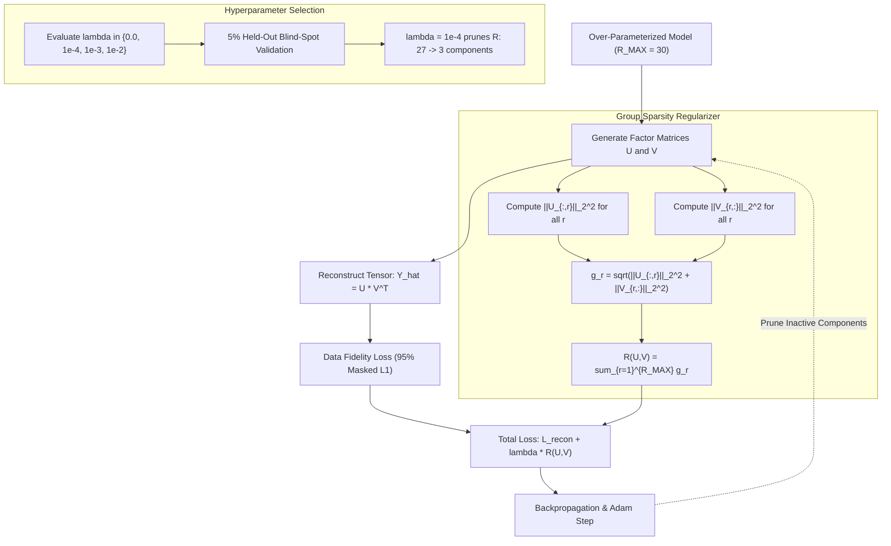
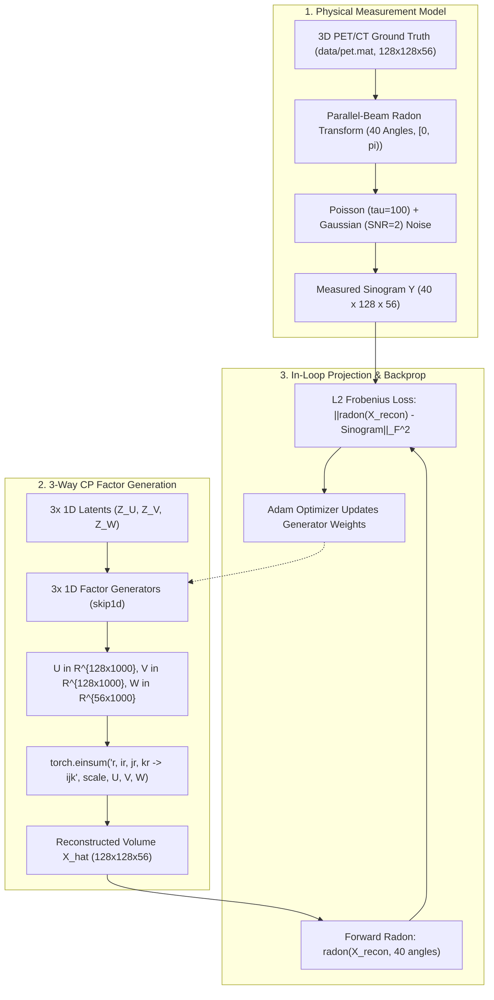
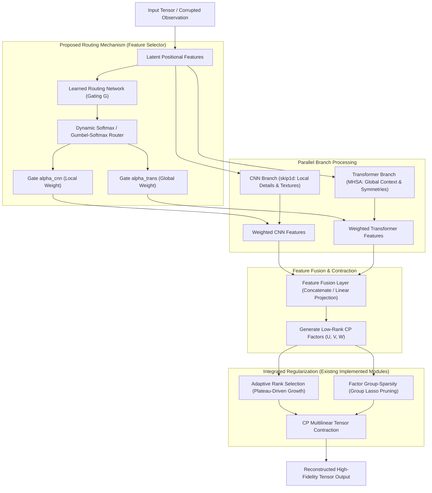

# DeepTensor — Code Dependency Diagrams

**Document ID:** EVAL-DIAG-01  
**Scope:** Architectural and Workflow Dependency Visualizations in Mermaid

---

## Workflow A: DeepTensor Baseline Workflow

---

## Workflow B: Five-Architecture Comparison Workflow

---

## Workflow C: Adaptive Rank Selection Workflow

---

## Workflow D: Factor Group-Sparsity Workflow

---

## Workflow E: PET/CT Radon Reconstruction Workflow

---

## Workflow F: Proposed Adaptive Hybrid Model Architecture (Future Work)

> [!NOTE]
> This diagram illustrates the proposed future architecture presented on Slide 27. It depicts how the implemented components will be integrated with an adaptive routing mechanism.

