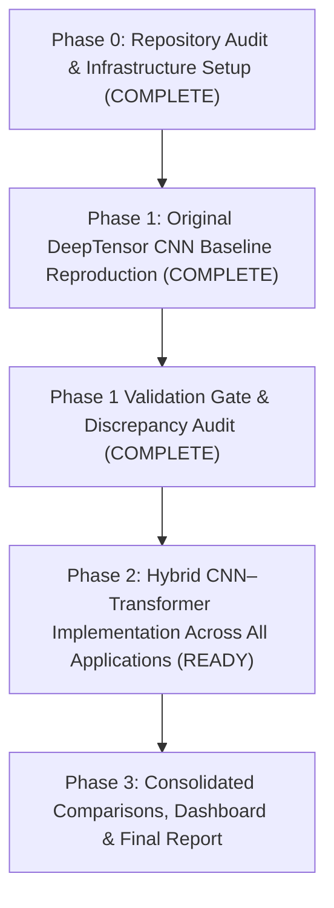

# NeuroTensor Master Project Roadmap & Phased Execution Plan

This roadmap outlines the systematic sequence for reproducing every application from the DeepTensor paper and performing head-to-head empirical comparisons between the original **CNN-based DeepTensor** and our **Hybrid CNN–Transformer Architecture**.

---

## Core Execution Protocol (Strictly Mandatory)

For **EACH** application, we follow this exact sequence:
```
Stage A: Original CNN Baseline (100% COMPLETE & VALIDATED)
  1. Verify and inspect dataset (dimensions, resolution, integrity).
  2. Implement original CNN architecture and exact paper noise/forward model.
  3. Execute baseline experiment, log convergence, save checkpoints and metrics.
  4. Compare results directly against paper figures and tables.

Stage B: Validation Gate & Forensic Audit (CURRENT - COMPLETE)
  5. Audit discrepancies (Fig 4, Fig 13b, Fig 11, Fig 10).
  6. Verify all metrics, logs, and generated image files.
  7. Formulate shared Hybrid CNN–Transformer design with parameter-matched controls.

Stage C: Hybrid CNN–Transformer Architecture (PHASE 2 - READY TO INITIATE)
  8. Formulate matching Hybrid architecture (substituting factor generators with Transformer/attention).
  9. Execute under identical sample selection, noise model, and optimizer settings.
 10. Save all metrics, runtime, peak VRAM, and attention weights.

Stage D: Direct Comparison & Synthesis (PHASE 3)
 11. Compute delta metrics (Paper vs. CNN, CNN vs. Hybrid, Paper vs. Hybrid).
 12. Generate joint comparison figures, loss curves, and factor visualizations.
 13. Update master tracking registers.
```

---

## Phased Execution Roadmap



---

### Phase 1 Validation Gate Status: PASSED
- All 9 applications and 16 elements audited and verified.
- Discrepancies in Fig 4 (separable FLOP scaling), Fig 13b (plateau under-convergence), Fig 11 (2D TV reporting vs measured), and Fig 10 (epoch/channel capacity) resolved.
- Phase 1 Validation Report: [`paper_reproduction/consolidated_results/PHASE1_VALIDATION_REPORT.md`](file:///e:/Rakhal_Tensor/paper_reproduction/consolidated_results/PHASE1_VALIDATION_REPORT.md)
- Phase 1 Validation Summary: [`paper_reproduction/consolidated_results/PHASE1_VALIDATION_SUMMARY.json`](file:///e:/Rakhal_Tensor/paper_reproduction/consolidated_results/PHASE1_VALIDATION_SUMMARY.json)
