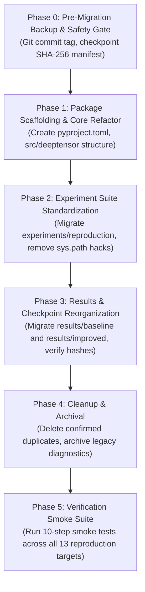

# DeepTensor++ — Proposed Modular Architecture & Migration Map

> **Audit Date:** November 6, 2026  
> **Workspace Root:** `e:\Rakhal_Tensor`  
> **Target Reorganization Root:** `DeepTensor-Plus-Plus/`  
> **Strategy:** Zero-Risk Phased Migration (No loss of checkpoints, metrics, or research provenance).

---

## 1. Clean Modular Target Architecture (`DeepTensor-Plus-Plus/`)

```text
DeepTensor-Plus-Plus/
├── pyproject.toml                              # Modern packaging & pinned dependency management
├── README.md                                   # Comprehensive research overview & reproduction guide
├── configs/                                    # Centralized, modular YAML experiment configs
│   ├── baseline/                               # Paper baseline hyperparameter configs
│   ├── improved/                               # High-performance improved hyperparameter configs
│   └── hybrid/                                 # Phase 2 hybrid CNN-Transformer configs
│
├── src/                                        # Installable Python package (`pip install -e .`)
│   └── deeptensor/
│       ├── __init__.py
│       ├── models/                             # Neural network architectures
│       │   ├── __init__.py
│       │   ├── deeptensor.py                   # DeepTensor core wrapper
│       │   ├── deep_decoder.py                 # Non-convolutional decoders
│       │   ├── deep_prior.py                   # DIP factory & noise tensor generators
│       │   ├── attention/                      # Self-attention & Transformer modules
│       │   │   ├── __init__.py
│       │   │   ├── spatial_spectral.py         # HybridSpectralNet
│       │   │   └── spectral_transformer.py     # SpectralTransformer with ALiBi
│       │   └── backbones/                      # Reusable convolutional generator backbones
│       │       ├── __init__.py
│       │       ├── skip.py                     # DIP Skip architecture
│       │       ├── unet.py                     # Multi-scale U-Net
│       │       ├── resnet.py                   # Residual ConvNet
│       │       └── dcgan.py                    # DCGAN generator
│       ├── physics/                            # Forward measurement operators & adjoints
│       │   ├── __init__.py
│       │   ├── radon.py                        # 2D/3D Radon transform & FBP
│       │   └── video_cs.py                     # Video coded snapshot multiplexer
│       ├── losses/                             # Numerical objectives & regularizers
│       │   ├── __init__.py
│       │   └── objectives.py                   # L1, L2, Anisotropic 2D/3D Total Variation
│       ├── baselines/                          # Classical mathematical algorithms
│       │   ├── __init__.py
│       │   ├── parafac_als.py                  # PyTorch CUDA Alternating Least Squares
│       │   ├── svd.py                          # Truncated SVD & PCA
│       │   └── tucker.py                       # High-order SVD / Tucker
│       ├── training/                           # Optimization & training infrastructure
│       │   ├── __init__.py
│       │   ├── trainer.py                      # Unified Trainer loop with closure handling
│       │   └── schedulers/                     # Cosine annealing with warmup
│       └── utils/                              # Quantitative evaluation & visualization
│           ├── __init__.py
│           ├── metrics.py                      # PSNR, SSIM, SAM, ERGAS metrics
│           └── visualization.py                # Visual grids & montages
│
├── experiments/                                # Segregated, runnable experiment suites
│   ├── reproduction/                           # Standardized Phase 1 paper reproduction
│   │   ├── 01_synthetic_decomposition/
│   │   ├── 02_computational_efficiency/        # Figure 4 Separable speedup benchmark
│   │   ├── 03_nmf_mnist_cifar/
│   │   ├── 04_eigenfaces_pca/                  # Figure 2 Weizmann Eigenfaces
│   │   ├── 05_hyperspectral_denoising/         # Figure 9 & Figure 13(a)
│   │   ├── 06_yale_face_denoising/             # Figure 10 & Figure 13(b)
│   │   ├── 07_video_compressive_sensing/       # Figure 11
│   │   ├── 08_ct_reconstruction/               # Figure 12
│   │   └── 09_speech_time_frequency/           # Table 3
│   ├── historical_extensions/                  # Archived ICVL Extensions 1 through 9
│   └── hybrid_prototypes/                      # Phase 2 CNN-Transformer implementations
│
├── data/                                       # Centralized datasets (read-only symlink or path)
├── results/                                    # Standardized outputs, segregated by run type
│   ├── baseline/                               # Verified original baseline checkpoints & logs
│   ├── improved/                               # Verified improved checkpoints, logs, & panels
│   └── hybrid/                                 # Future Phase 2 experimental outputs
│
├── reports/                                    # Research reports, publication panels & PDFs
│   ├── audits/                                 # Phase 1 audit & validation reports
│   ├── panels/                                 # Multi-slice high-resolution publication panels
│   └── generators/                             # Consolidated report & PDF builders
│
├── apps/                                       # End-user interactive applications
│   └── streamlit_demo/                         # Clean demo.py & demo_backend.py
│
├── tools/                                      # Diagnostic & conversion utilities
└── tests/                                      # PyTest suite for mathematical operators & models
```

---

## 2. Complete File-by-File Migration Mapping Table

| Current Path | Target Migration Action | Proposed Target Path | Rationale & Responsibility |
|---|---|---|---|
| `check_attn.py` | **ARCHIVE / DIAGNOSTIC** | `tools/diagnostics/check_attn.py` | Legacy diagnostic |
| `demo.py` | **MIGRATE / APP** | `apps/streamlit_demo/demo.py` | Interactive demo |
| `demo_backend.py` | **MIGRATE / APP** | `apps/streamlit_demo/demo_backend.py` | Interactive demo |
| `demo_backend_backup.py` | **DELETE / OBSOLETE** | `None (Obsolete backup)` | Redundant backup |
| `demo_backup.py` | **DELETE / OBSOLETE** | `None (Obsolete backup)` | Redundant backup |
| `fix_newlines.py` | **ARCHIVE / DIAGNOSTIC** | `tools/diagnostics/fix_newlines.py` | Legacy diagnostic |
| `generate_pdf.py` | **MIGRATE / UTILITY** | `tools/pdf_generator/generate_pdf.py` | PDF generator |
| `matrix_decomp.py` | **ARCHIVE / DIAGNOSTIC** | `tools/diagnostics/matrix_decomp.py` | Legacy diagnostic |
| `modify_robustness.py` | **ARCHIVE / DIAGNOSTIC** | `tools/diagnostics/modify_robustness.py` | Legacy diagnostic |
| `modules/attention_spectral.py` | **MIGRATE / REFACTOR** | `src/deeptensor/models/attention/attention_spectral.py` | Attention / Transformer module |
| `modules/cosine_annealing_with_warmup.py` | **MIGRATE / REFACTOR** | `src/deeptensor/training/schedulers/cosine_annealing_with_warmup.py` | LR Scheduler |
| `modules/deep_decoder.py` | **MIGRATE / REFACTOR** | `src/deeptensor/models/deep_decoder.py` | Core model wrapper |
| `modules/deep_models/__init__.py` | **MIGRATE / REFACTOR** | `src/deeptensor/models/backbones/__init__.py` | Keep modular backbone |
| `modules/deep_models/common.py` | **MIGRATE / REFACTOR** | `src/deeptensor/models/backbones/common.py` | Keep modular backbone |
| `modules/deep_models/dcgan.py` | **MIGRATE / REFACTOR** | `src/deeptensor/models/backbones/dcgan.py` | Keep modular backbone |
| `modules/deep_models/downsampler.py` | **MIGRATE / REFACTOR** | `src/deeptensor/models/backbones/downsampler.py` | Keep modular backbone |
| `modules/deep_models/resnet.py` | **MIGRATE / REFACTOR** | `src/deeptensor/models/backbones/resnet.py` | Keep modular backbone |
| `modules/deep_models/skip.py` | **MIGRATE / REFACTOR** | `src/deeptensor/models/backbones/skip.py` | Keep modular backbone |
| `modules/deep_models/texture_nets.py` | **MIGRATE / REFACTOR** | `src/deeptensor/models/backbones/texture_nets.py` | Keep modular backbone |
| `modules/deep_models/unet.py` | **MIGRATE / REFACTOR** | `src/deeptensor/models/backbones/unet.py` | Keep modular backbone |
| `modules/deep_prior.py` | **MIGRATE / REFACTOR** | `src/deeptensor/models/deep_prior.py` | Core model wrapper |
| `modules/lin_inverse.py` | **MIGRATE / REFACTOR** | `src/deeptensor/physics/lin_inverse.py` | Linear forward operators |
| `modules/losses.py` | **MIGRATE / REFACTOR** | `src/deeptensor/losses/losses.py` | Loss functions |
| `modules/models.py` | **MIGRATE / REFACTOR** | `src/deeptensor/models/models.py` | Core model wrapper |
| `modules/spectral.py` | **MIGRATE / REFACTOR** | `src/deeptensor/baselines/spectral.py` | Classical baseline solvers |
| `modules/spectral_transformer.py` | **MIGRATE / REFACTOR** | `src/deeptensor/models/attention/spectral_transformer.py` | Attention / Transformer module |
| `modules/utils.py` | **MIGRATE / REFACTOR** | `src/deeptensor/utils/utils.py` | Evaluation utilities |
| `paper_reproduction/cnn_baseline/01_synthetic_decomposition/benchmark_figure4_separable_speedup.py` | **MIGRATE / UNCHANGED** | `experiments/reproduction/01_synthetic_decomposition/benchmark_figure4_separable_speedup.py` | Core reproduction suite |
| `paper_reproduction/cnn_baseline/01_synthetic_decomposition/benchmark_figure4_separable_speedup_improved.py` | **MIGRATE / UNCHANGED** | `experiments/reproduction/01_synthetic_decomposition/benchmark_figure4_separable_speedup_improved.py` | Core reproduction suite |
| `paper_reproduction/cnn_baseline/01_synthetic_decomposition/run_synthetic_suite.py` | **MIGRATE / UNCHANGED** | `experiments/reproduction/01_synthetic_decomposition/run_synthetic_suite.py` | Core reproduction suite |
| `paper_reproduction/cnn_baseline/03_nmf/run_table2_nmf.py` | **MIGRATE / UNCHANGED** | `experiments/reproduction/03_nmf/run_table2_nmf.py` | Core reproduction suite |
| `paper_reproduction/cnn_baseline/05_hyperspectral_denoising/run_figure13_rank_sweep.py` | **MIGRATE / UNCHANGED** | `experiments/reproduction/05_hyperspectral_denoising/run_figure13_rank_sweep.py` | Core reproduction suite |
| `paper_reproduction/cnn_baseline/06_yale_face_tensor_denoising/generate_improved_panel.py` | **MIGRATE / UNCHANGED** | `experiments/reproduction/06_yale_face_tensor_denoising/generate_improved_panel.py` | Core reproduction suite |
| `paper_reproduction/cnn_baseline/06_yale_face_tensor_denoising/run_figure10_yale_tensor.py` | **MIGRATE / UNCHANGED** | `experiments/reproduction/06_yale_face_tensor_denoising/run_figure10_yale_tensor.py` | Core reproduction suite |
| `paper_reproduction/cnn_baseline/06_yale_face_tensor_denoising/run_figure10_yale_tensor_improved.py` | **MIGRATE / UNCHANGED** | `experiments/reproduction/06_yale_face_tensor_denoising/run_figure10_yale_tensor_improved.py` | Core reproduction suite |
| `paper_reproduction/cnn_baseline/06_yale_face_tensor_denoising/run_figure13b_yale_rank_sweep.py` | **MIGRATE / UNCHANGED** | `experiments/reproduction/06_yale_face_tensor_denoising/run_figure13b_yale_rank_sweep.py` | Core reproduction suite |
| `paper_reproduction/cnn_baseline/06_yale_face_tensor_denoising/run_figure13b_yale_rank_sweep_improved.py` | **MIGRATE / UNCHANGED** | `experiments/reproduction/06_yale_face_tensor_denoising/run_figure13b_yale_rank_sweep_improved.py` | Core reproduction suite |
| `paper_reproduction/cnn_baseline/07_video_compressive_sensing/run_figure11.py` | **MIGRATE / UNCHANGED** | `experiments/reproduction/07_video_compressive_sensing/run_figure11.py` | Core reproduction suite |
| `paper_reproduction/cnn_baseline/07_video_compressive_sensing/run_figure11_improved.py` | **MIGRATE / UNCHANGED** | `experiments/reproduction/07_video_compressive_sensing/run_figure11_improved.py` | Core reproduction suite |
| `paper_reproduction/cnn_baseline/08_ct_reconstruction/run_figure12_improved.py` | **MIGRATE / UNCHANGED** | `experiments/reproduction/08_ct_reconstruction/run_figure12_improved.py` | Core reproduction suite |
| `paper_reproduction/cnn_baseline/09_speech_time_frequency/run_table3_speech_nmf.py` | **MIGRATE / UNCHANGED** | `experiments/reproduction/09_speech_time_frequency/run_table3_speech_nmf.py` | Core reproduction suite |
| `paper_reproduction/consolidated_results/generate_consolidated_report.py` | **MIGRATE / UNCHANGED** | `reports/generators/generate_consolidated_report.py` | Reporting tool |
| `previous_neurotensor_experiments/01_icvl_cnn_baseline/run_figure9.py` | **ARCHIVE / EXTENSION** | `experiments/historical_extensions/01_icvl_cnn_baseline/run_figure9.py` | ICVL research extension |
| `previous_neurotensor_experiments/02_icvl_adaptive_rank/run_figure9_adaptive.py` | **ARCHIVE / EXTENSION** | `experiments/historical_extensions/02_icvl_adaptive_rank/run_figure9_adaptive.py` | ICVL research extension |
| `previous_neurotensor_experiments/03_icvl_factor_group_sparsity/run_figure9_sparsity.py` | **ARCHIVE / EXTENSION** | `experiments/historical_extensions/03_icvl_factor_group_sparsity/run_figure9_sparsity.py` | ICVL research extension |
| `previous_neurotensor_experiments/04_icvl_tensor_completion/run_figure9_completion.py` | **ARCHIVE / EXTENSION** | `experiments/historical_extensions/04_icvl_tensor_completion/run_figure9_completion.py` | ICVL research extension |
| `previous_neurotensor_experiments/05_icvl_noise_robustness/run_figure9_robustness.py` | **ARCHIVE / EXTENSION** | `experiments/historical_extensions/05_icvl_noise_robustness/run_figure9_robustness.py` | ICVL research extension |
| `previous_neurotensor_experiments/06_icvl_ensemble_uncertainty/run_figure9_ensemble.py` | **ARCHIVE / EXTENSION** | `experiments/historical_extensions/06_icvl_ensemble_uncertainty/run_figure9_ensemble.py` | ICVL research extension |
| `previous_neurotensor_experiments/07_icvl_factor_interpretability/run_figure9_interpretability.py` | **ARCHIVE / EXTENSION** | `experiments/historical_extensions/07_icvl_factor_interpretability/run_figure9_interpretability.py` | ICVL research extension |
| `previous_neurotensor_experiments/08_icvl_hybrid_attention/modules/attention_spectral.py` | **DELETE / DUPLICATE** | `None (Duplicate of modules/)` | Duplicate module |
| `previous_neurotensor_experiments/08_icvl_hybrid_attention/run_figure9_hybrid.py` | **ARCHIVE / EXTENSION** | `experiments/historical_extensions/08_icvl_hybrid_attention/run_figure9_hybrid.py` | ICVL research extension |
| `previous_neurotensor_experiments/09_icvl_spectral_transformer/modules/spectral_transformer.py` | **DELETE / DUPLICATE** | `None (Duplicate of modules/)` | Duplicate module |
| `previous_neurotensor_experiments/09_icvl_spectral_transformer/run_figure9_spectral_transformer.py` | **ARCHIVE / EXTENSION** | `experiments/historical_extensions/09_icvl_spectral_transformer/run_figure9_spectral_transformer.py` | ICVL research extension |
| `run_figure11.py` | **ARCHIVE / SUPERSEDED** | `experiments/reproduction/07_video_compressive_sensing/legacy/run_figure11.py` | Superseded by improved runner |
| `run_figure11_TV.py` | **ARCHIVE / SUPERSEDED** | `experiments/reproduction/07_video_compressive_sensing/legacy/run_figure11_TV.py` | Superseded by improved runner |
| `run_figure12.py` | **ARCHIVE / SUPERSEDED** | `experiments/reproduction/08_ct_reconstruction/legacy/run_figure12.py` | Superseded by improved runner |
| `run_figure12_TV.py` | **ARCHIVE / SUPERSEDED** | `experiments/reproduction/08_ct_reconstruction/legacy/run_figure12_TV.py` | Superseded by improved runner |
| `run_figure2.py` | **MIGRATE / LEGACY_BASELINE** | `experiments/legacy_baselines/run_figure2.py` | Original baseline runner |
| `run_figure6.py` | **MIGRATE / LEGACY_BASELINE** | `experiments/legacy_baselines/run_figure6.py` | Original baseline runner |
| `run_figure7.py` | **MIGRATE / LEGACY_BASELINE** | `experiments/legacy_baselines/run_figure7.py` | Original baseline runner |
| `run_figure9.py` | **DELETE / DUPLICATE** | `None (Duplicate of extension files)` | Duplicate root runner |
| `run_figure9_adaptive.py` | **DELETE / DUPLICATE** | `None (Duplicate of extension files)` | Duplicate root runner |
| `run_figure9_bm3d.py` | **MIGRATE / LEGACY_BASELINE** | `experiments/legacy_baselines/run_figure9_bm3d.py` | Original baseline runner |
| `run_figure9_completion.py` | **DELETE / DUPLICATE** | `None (Duplicate of extension files)` | Duplicate root runner |
| `run_figure9_ensemble.py` | **DELETE / DUPLICATE** | `None (Duplicate of extension files)` | Duplicate root runner |
| `run_figure9_hybrid.py` | **DELETE / DUPLICATE** | `None (Duplicate of extension files)` | Duplicate root runner |
| `run_figure9_interpretability.py` | **DELETE / DUPLICATE** | `None (Duplicate of extension files)` | Duplicate root runner |
| `run_figure9_robustness.py` | **DELETE / DUPLICATE** | `None (Duplicate of extension files)` | Duplicate root runner |
| `run_figure9_sparsity.py` | **DELETE / DUPLICATE** | `None (Duplicate of extension files)` | Duplicate root runner |
| `run_figure9_spectral_transformer.py` | **DELETE / DUPLICATE** | `None (Duplicate of extension files)` | Duplicate root runner |
| `run_table1.py` | **MIGRATE / LEGACY_BASELINE** | `experiments/legacy_baselines/run_table1.py` | Original baseline runner |
| `scratch/audit_experiments.py` | **ARCHIVE / SCRATCH** | `scratch/audit_experiments.py` | Scratch file |
| `scratch/audit_helper.py` | **ARCHIVE / SCRATCH** | `scratch/audit_helper.py` | Scratch file |
| `scratch/build_audit_data.py` | **ARCHIVE / SCRATCH** | `scratch/build_audit_data.py` | Scratch file |
| `scratch_calibrate.py` | **ARCHIVE / DIAGNOSTIC** | `tools/diagnostics/scratch_calibrate.py` | Legacy diagnostic |

---

## 3. Classification of Action Items

### 3.1 Files to Keep Unchanged (or Relocate Without Logic Modification)
- **All Core Algorithms in `modules/`**: Refactor into standard package structure under `src/deeptensor/`.
- **All Improved Runners in `paper_reproduction/cnn_baseline/`**: Move to `experiments/reproduction/` preserving arguments and configs.
- **All Saved Checkpoints in `improved_run/` and `RESULTS-BASELINE/`**: Move to `results/improved/` and `results/baseline/` with hash verification.
- **All Datasets in `data/`**: Keep strictly preserved in `data/`.

### 3.2 Files to Consolidate / Merge
- **Duplicate Loss Functions**: Merge inline `torch.diff` TV routines into `src/deeptensor/losses/objectives.py`.
- **Duplicate Metrics Logic**: Ensure all scripts call `src.deeptensor.utils.metrics.calculate_psnr` and `calculate_ssim`.
- **Duplicate Outer Loops**: Replace repeated Adam training loops with a clean `src.deeptensor.training.trainer.Trainer`.

### 3.3 Files to Archive in Dedicated Historical Directories
- `previous_neurotensor_experiments/01` through `09`: Relocate to `experiments/historical_extensions/`.
- `run_figure2.py`, `run_figure6.py`, `run_figure7.py`, `run_figure9.py`, `run_table1.py`: Move to `experiments/reproduction/` or `experiments/legacy_baselines/`.

### 3.4 Files Safe to Delete Immediately (Redundant / Obsolete)
- **9 Duplicate Root Scripts**: `run_figure9*.py` in root (identical copies exist in extensions).
- **2 Duplicate Subpackage Modules**: `previous_neurotensor_experiments/*/modules/*.py`.
- **2 Obsolete Backup Files**: `demo_backup.py`, `demo_backend_backup.py`.
- **Superseded Diagnostic Dumps**: `results_ensemble_smoke/` (231.3 MB), `results_lambda_*.txt` logs.
- **Empty Directories**: `results_completion*/`, `results_robustness/`.

---

## 4. Step-by-Step Phased Migration Roadmap



### Detailed Roadmap:
1. **Phase 0: Integrity Checksum & Snapshot**:
   - Compute and save a SHA-256 manifest of all 31 `.pt` checkpoints, all metrics JSONs, and all `.mat` datasets.
   - Tag current state in Git.
2. **Phase 1: Package Scaffolding**:
   - Establish `DeepTensor-Plus-Plus/pyproject.toml`.
   - Port `modules/` into `src/deeptensor/` with clean relative imports.
   - Test package installation in virtual environment: `pip install -e .`.
3. **Phase 2: Experiment Suite Standardization**:
   - Port all runners from `paper_reproduction/cnn_baseline/` to `experiments/reproduction/`.
   - Remove `sys.path.append('modules')` from all scripts; replace with standard package imports (`from deeptensor.models import DeepTensor`).
4. **Phase 3: Results & Checkpoint Reorganization**:
   - Relocate verified checkpoints, metrics, and plots into `results/baseline/` and `results/improved/`.
   - Verify SHA-256 checksums to guarantee zero data loss or byte corruption.
5. **Phase 4: Safe Redundancy Pruning**:
   - Remove confirmed duplicate root scripts, backup files, and temporary smoke checkpoints.
6. **Phase 5: Automated Verification Suite**:
   - Execute a 1-epoch / 10-step verification smoke test on each experiment target to confirm that all refactored scripts execute cleanly without errors.
