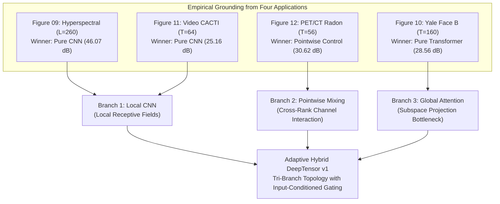
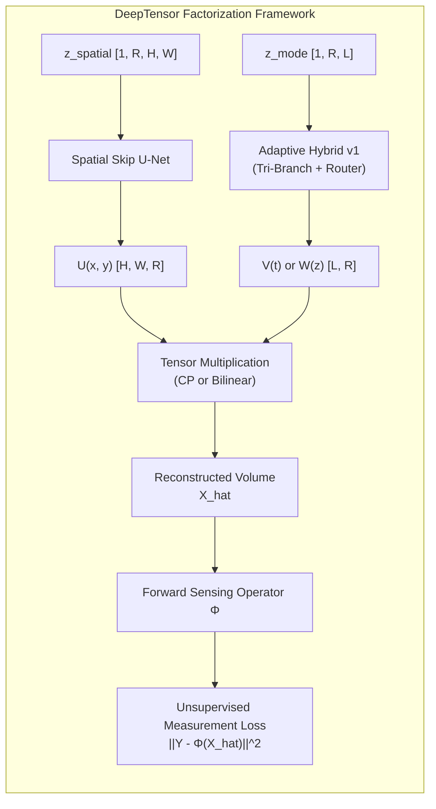
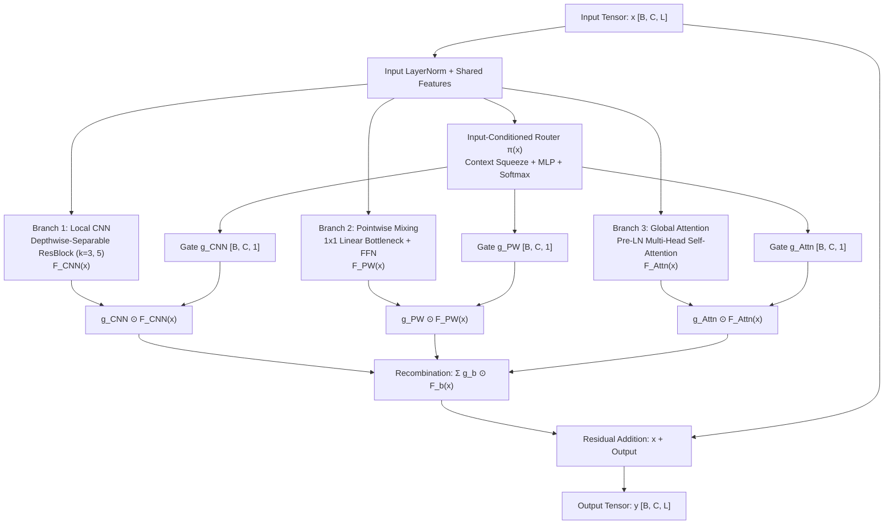

# DeepTensor++ Research Design: Adaptive Hybrid DeepTensor v1
**Tri-Branch Architecture with Input-Conditioned Inductive Gating**

**Date:** 2026-11-08  
**Target:** Unified Adaptive DeepTensor Architecture for Multi-Dimensional Tensor Factorization  
**Experimental Foundation:** Verified Empirical Results across Figures 09, 10, 11, and 12  
**Status:** Architecture Proposal & Experimental Protocol (Design Only — Awaiting User Approval)  

---

## 1. Executive Summary & Epistemological Framework

### 1.1 Epistemological Framework: Separating Evidence, Explanations, and Hypotheses
To maintain scientific rigor throughout the development of DeepTensor++, this research design strictly separates three categories of statements:
1. **Empirical Observations (Verified Evidence):** Direct numerical measurements obtained from full-scale experimental runs and independently reproduced directly from saved checkpoints with $0.0000\text{ dB}$ discrepancy.
2. **Proposed Explanations (Theoretical Models):** Mechanistic rationales that plausibly account for observed performance based on signal processing principles and network properties. These explanations remain open to alternative interpretations.
3. **Untested Hypotheses (Experimental Targets):** Explicit research questions that the proposed Adaptive Hybrid v1 architecture is designed to investigate. **We assert no guaranteed performance improvements prior to execution.**

```
Empirical Results Summary across DeepTensor++ Applications (Authoritative Ground Truth):
┌────────────┬───────────────────────┬──────────────┬──────────────────┬──────────────┬──────────────────────────────────────────┐
│ Experiment │ Modality & Physics    │ Rank / Dims  │ Winning Variant  │ Top Metric   │ Observed Performance Hierarchy           │
├────────────┼───────────────────────┼──────────────┼──────────────────┼──────────────┼──────────────────────────────────────────┤
│ Figure 09  │ ICVL Hyperspectral    │ R=20         │ Pure CNN         │ 46.07 dB     │ Baseline (46.07) > CNN Control (45.58) > │
│            │ (Poisson + Gaussian)  │ 174x164x260  │ (Baseline)       │ (SSIM 0.993) │ PW (45.42) > Hybrid (44.85) > Trans (43.40)│
├────────────┼───────────────────────┼──────────────┼──────────────────┼──────────────┼──────────────────────────────────────────┤
│ Figure 10  │ Yale Face B           │ R=2000       │ Pure Transformer │ 28.56 dB     │ Trans (28.56) > CNN Control (28.35) >    │
│            │ (30% Impulse Noise)   │ 192x168x160  │                  │ (SSIM 0.866) │ PW (28.17) > Hybrid (28.04) > Base (27.78)│
├────────────┼───────────────────────┼──────────────┼──────────────────┼──────────────┼──────────────────────────────────────────┤
│ Figure 11  │ Video CS (CACTI)      │ R=32         │ Pure CNN         │ 25.16 dB     │ Baseline (25.16) > CNN Control (25.04) > │
│            │ (8x Multiplexing)     │ 128x128x64   │ (Baseline)       │ (SSIM 0.722) │ PW (24.81) > Hybrid (24.74) > Trans (24.05)│
├────────────┼───────────────────────┼──────────────┼──────────────────┼──────────────┼──────────────────────────────────────────┤
│ Figure 12  │ 3D PET/CT Radon CS    │ R=1000       │ Pointwise        │ 30.62 dB     │ PW (30.62) > Trans (30.41) >            │
│            │ (40-Angle Tomography) │ 128x128x56   │ Control          │ (SSIM 0.862) │ CNN Control (30.31) > Hyb (30.29) > Base (30.00)│
└────────────┴───────────────────────┴──────────────┴──────────────────┴──────────────┴──────────────────────────────────────────┘
```

---

### 1.2 The Core Scientific Problem
1. **The Naive Hybrid Paradox (Empirical Fact):**  
   Across all four completed applications, the naive sequential hybrid ($x \to \text{CNN} \to \text{LayerNorm} \to \text{MHSA} \to \text{FFN} \to y$) **never achieved top performance**.
2. **Proposed Explanations:**
   - *In continuous physical domains (Figs 09 & 11):* Stacking global attention onto a CNN allows distant tokens to cross-attend during unsupervised optimization, fitting noise and inducing temporal/spectral phase leakage.
   - *In discrete or high-rank regimes (Figs 10 & 12):* Forcing features through local convolutional windows prematurely smears sharp boundary transitions before global attention or pointwise mixing can process them.
   - *Static Coupling:* Sequential stacking forces every representation to suffer the inductive limitations of both mechanisms without adaptability.
3. **The Adaptive Hybrid DeepTensor v1 Proposal:**  
   We propose decoupling local convolution, pointwise rank mixing, and global self-attention into **three parallel branches**, combined via an **input-conditioned gating router**. The research goal is to determine whether an adaptive architecture can dynamically adjust its inductive bias to remain competitive across heterogeneous physical modalities without manual task-specific redesign.

---

## 2. Empirical Foundation: Architectural Lessons Across Applications



### 2.1 Detailed Application Breakdown

#### Application 1: Figure 09 — ICVL Hyperspectral Denoising & Super-Resolution
- **Observation:** Baseline CNN achieved $46.07\text{ dB}$, outperforming Hybrid ($44.85\text{ dB}$) by $+1.21\text{ dB}$ and Transformer ($43.40\text{ dB}$) by $+2.66\text{ dB}$.
- **Proposed Explanation:** Reflectance spectra are locally continuous and smooth (governed by physical absorption bands). Compact 1D convolutional kernels naturally enforce this smoothness prior. Unconstrained dot-product attention lacks local smoothness bias and can fit high-frequency noise across distant wavelengths.
- **Untested Hypothesis:** When applied to continuous spectral data, an input-conditioned gating mechanism will learn to assign dominant weight to the convolutional branch ($\bar{\mathbf{g}}_{\text{CNN}} \gg \bar{\mathbf{g}}_{\text{Attn}}$).

#### Application 2: Figure 10 — Yale Face B Multi-Illumination Tensor Denoising
- **Observation:** Pure Transformer achieved $28.56\text{ dB}$, outperforming Baseline CNN ($27.78\text{ dB}$) by $+0.77\text{ dB}$ and Hybrid ($28.04\text{ dB}$) by $+0.51\text{ dB}$.
- **Proposed Explanation:** Under 30% Salt & Pepper noise with high CP rank ($R=2000$), the Transformer's linear projection bottleneck ($\mathbb{R}^{2000} \to \mathbb{R}^{128} \to \mathbb{R}^{2000}$) acts as a strong subspace regularizer. Local 1D convolutions perform worse because adjacent sequence indices in the dataset jump discontinuously across azimuth and elevation.
- **Untested Hypothesis:** For high-rank discrete sequences, the router will allocate substantial gating weight to the attention branch and bottleneck mixing, while downweighting local convolutions.

#### Application 3: Figure 11 — Video Compressive Sensing (CACTI)
- **Observation:** Baseline CNN achieved $25.16\text{ dB}$, outperforming Hybrid ($24.74\text{ dB}$) by $+0.41\text{ dB}$ and Transformer ($24.05\text{ dB}$) by $+1.11\text{ dB}$. Parameter-matched CNN Control ($25.04\text{ dB}$) beat Hybrid by $+0.30\text{ dB}$.
- **Proposed Explanation:** Temporal compressive multiplexing collapses 8 video frames into 1 coded snapshot. Because motion is physically continuous between adjacent frames, compact 1D temporal receptive fields prevent non-local temporal phase leakage. Global self-attention allows frames to cross-attend across long temporal spans, causing temporal blurring.
- **Untested Hypothesis:** For temporal demultiplexing, the adaptive router will heavily weight Branch 1 (CNN) to preserve compact temporal locality.

#### Application 4: Figure 12 — 3D PET/CT Radon Compressive Sensing
- **Observation:** Pointwise Control achieved $30.62\text{ dB}$, outperforming Baseline CNN ($30.00\text{ dB}$) by $+0.62\text{ dB}$, Hybrid ($30.29\text{ dB}$) by $+0.33\text{ dB}$, and CNN Control ($30.31\text{ dB}$) by $+0.31\text{ dB}$.
- **Proposed Explanation:** Sparse-angle Radon reconstruction suffers from radial streak artifacts. While multi-scale 1D convolutions smear sharp vertical tissue boundaries across adjacent slices, position-independent pointwise mixing allows the 1,000 CP rank components to coordinate without inducing cross-slice partial volume blurring.
- **Untested Hypothesis:** For multi-slice tomographic inversion, the router will assign dominant capacity to Branch 2 (Pointwise Mixing).

---

## 3. Architecture Specification: Tri-Branch Module

### 3.1 Macro-Architecture & Preservation of Factorization Framework
Adaptive Hybrid DeepTensor v1 preserves 100% of the underlying tensor factorization mathematics and physical sensing models:
- **Spatial Factor Network ($U$):** Unchanged 2D Deep Image Prior Skip U-Net generating spatial basis features $\mathbf{U} \in \mathbb{R}^{H \times W \times R}$.
- **Core Weights ($\lambda$):** Learnable diagonal core vector $\lambda \in \mathbb{R}^R$ initialized to $1/R$.
- **Forward Measurement Operators ($\Phi$):** Identity mask, CACTI temporal multiplexer, and Radon transform projection operators remain completely unchanged.
- **Target Replacement:** The Adaptive Hybrid module replaces the mode factor generator (e.g., $V(\lambda)$ in Fig 09, $W(z)$ in Fig 10, $V(t)$ in Fig 11, $W(z)$ in Fig 12).



---

### 3.2 Micro-Architecture: The Tri-Branch Topology
Let the input feature representation at depth $l$ be $\mathbf{x} \in \mathbb{R}^{B \times C \times L}$, where $B=1$ (single-instance DIP), $C$ is the latent channel dimension ($C = 128$ for Figs 09, 10, 12; $C = 64$ for Fig 11), and $L$ is sequence length.



#### Detailed Branch Specifications:

1. **Branch 1: Local Convolutional Branch ($\mathcal{F}_{\text{CNN}}$)**  
   - Normalization: `nn.GroupNorm(num_groups=4, num_channels=C)` (stable for $B=1$).
   - Convolutions: Depthwise 1D conv ($k=3$), $1\times 1$ pointwise expansion to $c_{\text{cnn}}$, GELU activation, depthwise 1D conv ($k=5$), and $1\times 1$ pointwise projection back to $C$.
   - Formulation:
     $$\mathcal{F}_{\text{CNN}}(\mathbf{x}) = \text{PWConv2}\left(\text{DWConv5}\left(\text{GELU}\left(\text{PWConv1}\left(\text{DWConv3}\left(\text{GroupNorm}(\mathbf{x})\right)\right)\right)\right)\right)$$

2. **Branch 2: Pointwise Channel/Rank Mixing Branch ($\mathcal{F}_{\text{PW}}$)**  
   - Normalization: `nn.LayerNorm(C)` applied across channels independently at each position $t$.
   - Architecture: Linear projection to $c_{\text{pw}}$, GELU activation, and linear projection back to $C$.
   - Formulation (computed independently for each position $t \in [1, L]$):
     $$\mathcal{F}_{\text{PW}}(\mathbf{x}_{:, t}) = W_2 \, \text{GELU}(W_1 \, \text{LayerNorm}(\mathbf{x}_{:, t}) + b_1) + b_2, \quad W_1 \in \mathbb{R}^{c_{\text{pw}} \times C}, \; W_2 \in \mathbb{R}^{C \times c_{\text{pw}}}$$

3. **Branch 3: Global Dependency Modelling Branch ($\mathcal{F}_{\text{Attn}}$)**  
   - Normalization: Pre-LN `nn.LayerNorm(C)`.
   - Projection Bottleneck: Linear projection from $C$ to $d_{\text{attn}}$.
   - Multi-Head Self-Attention: $h = 2$ heads, head dimension $d_k = d_{\text{attn}} / 2$, followed by projection back to $C$.
   - Feed-Forward Network: Pre-LN with linear expansion to $d_{\text{attn}}$ and projection back to $C$.
   - Formulation:
     $$\mathbf{z} = \text{Proj}_{\text{in}}\left(\text{LayerNorm}(\mathbf{x}^\top + \mathbf{P})\right) \in \mathbb{R}^{L \times d_{\text{attn}}}$$
     $$\mathbf{a} = \text{Proj}_{\text{out}}\left(\text{MHA}(\mathbf{z}, \mathbf{z}, \mathbf{z})\right)^\top \in \mathbb{R}^{C \times L}$$
     $$\mathcal{F}_{\text{Attn}}(\mathbf{x}) = \mathbf{a} + \text{FFN}(\text{LayerNorm}(\mathbf{a}^\top))^\top$$

---

## 4. Input-Conditioned Adaptive Gating & Router Information

### 4.1 Analysis of Router Information & Limitations of Global Average Pooling (GAP)
The primary router design uses Global Average Pooling to compute a summary context vector:
$$\mathbf{s} = \frac{1}{L} \sum_{t=1}^L \mathbf{x}_{:, t} \in \mathbb{R}^C$$

#### Limitations of GAP:
1. **Spatial/Temporal Blindness:** By averaging over the entire sequence length $L$, GAP discards all local coordinate information. In non-stationary sequences (such as video sequences where fast motion is localized to a 10-frame sub-window, or CT scans where peripheral slices contain soft tissue while central slices contain high-density bone), GAP cannot dynamically adjust gating weights across sequence positions $t$.
2. **Dilution of Localized Features:** Transient high-frequency signals or sharp gradient changes are diluted when averaged across long sequences ($L=260$ in Fig 09 or $L=160$ in Fig 10).

#### Why Channel-Wise CAGC is Retained as Primary:
Despite GAP's sequence-level pooling, **Channel-Aware Global Context Gate (CAGC)** is retained as the primary design for three reasons:
- **Channel Specialization:** It allows individual feature channels $c \in [1, C]$ to specialize into distinct inductive roles (e.g. edge-tracking channels route to CNN; coordinate-alignment channels route to Pointwise or Attention).
- **Extreme Parameter Efficiency:** It requires only $8,592$ parameters ($6.49\%$ of module capacity for $d_{\text{model}}=128$), avoiding parameter fragmentation.
- **DIP Stability:** In single-instance unsupervised optimization, sequence-averaged context vectors $\mathbf{s}$ filter out zero-mean latent perturbation noise ($\sigma=1/30$), preventing chaotic gate oscillations.

---

### 4.2 Lightweight Position-Aware Gating Ablation (Low-Rank Factorized Gate)
To rigorously address GAP's temporal/spatial blindness without introducing an unconstrained, overparameterized $C \times L \times 3$ gate (which would add $>50,000$ parameters and overfit to noise), we specify a **Low-Rank Factorized Channel-Position Gate (LR-CPG)** as an explicit ablation:

$$\mathbf{G}(c, t, b) = \text{Softmax}_b\left( U_{\text{chan}}(c, b) + U_{\text{pos}}(t, b) \right)$$

1. **Channel Component ($U_{\text{chan}}$):** Computed via the standard CAGC context router ($U_{\text{chan}} \in \mathbb{R}^{C \times 3}$).
2. **Position Component ($U_{\text{pos}}$):** Computed via a lightweight 1D depthwise convolution:
   $$U_{\text{pos}} = \text{Conv1d}_{1\times 1}\left(\text{GELU}\left(\text{DWConv1d}_{k=3}(\mathbf{x})\right)\right) \in \mathbb{R}^{3 \times L}$$
   - Depthwise conv ($k=3$, padding 1): $3 \times C + C = 4C$ parameters.
   - Pointwise conv ($C \to 3$): $3C + 3$ parameters.
   - For $C=128$, the position module adds only **$903$ parameters** ($<0.7\%$ of module budget)!
This lightweight ablation grants position-dependent gating while maintaining strict parameter parity.

---

### 4.3 Positional Encoding Protocol & Yale Face B Physical Coordinates

The experimental protocol will evaluate three distinct positional encoding controls across all models:

```
Positional Encoding Experimental Matrix:
┌─────────────────┬────────────────────────────────────────────────────────┬────────────────────────────────────────────┐
│ PE Strategy     │ Mathematical Formulation                               │ Physical Meaning                           │
├─────────────────┼────────────────────────────────────────────────────────┼────────────────────────────────────────────┤
│ 1. No-PE        │ P = 0 (Zero additive coordinate)                       │ Pure translation invariance; tests whether │
│                 │                                                        │ network can route without coordinate cues  │
├─────────────────┼────────────────────────────────────────────────────────┼────────────────────────────────────────────┤
│ 2. Sin-PE       │ Continuous sinusoidal embeddings:                      │ Assumes continuous integer sequence index  │
│                 │ P(t, 2i)   = sin(t / 10000^(2i/C))                     │ progression t in [1, L]                    │
│                 │ P(t, 2i+1) = cos(t / 10000^(2i/C))                     │                                            │
├─────────────────┼────────────────────────────────────────────────────────┼────────────────────────────────────────────┤
│ 3. Phys-PE      │ Physical acquisition coordinate mapping:               │ Physically faithful continuous coordinates │
│                 │ p_t in R^d -> Linear(p_t) or Fourier Features          │ grounded in acquisition geometry           │
└─────────────────┴────────────────────────────────────────────────────────┴────────────────────────────────────────────┘
```

#### Application-Specific Grounding of Phys-PE:
- **Figure 09 (ICVL):** Actual physical wavelength in nanometers $\lambda_t \in [400\text{ nm}, 700\text{ nm}]$ mapped via continuous 1D Fourier feature embeddings.
- **Figure 10 (Yale Face B) — Physical Illumination Coordinates:**  
  *Critical Methodological Fact:* In the Extended Yale Face B dataset, filenames (e.g. `yaleB01_P00A+000E+00.pgm`) reflect alphanumeric string sorting, **which does not represent physical illumination continuity**. Adjacent indices jump by up to $110^\circ$ across azimuth and elevation. Assuming filename order represents physical spatial proximity introduces artificial ordering bias.  
  Under `Phys-PE`, each illumination condition is mapped to its true physical 3D light-source direction vector on the unit sphere:
  $$\mathbf{n}_t = \begin{pmatrix} \cos \theta_t \sin \phi_t \\ \sin \theta_t \\ \cos \theta_t \cos \phi_t \end{pmatrix} \in \mathbb{R}^3$$
  where $\phi_t \in [-130^\circ, +130^\circ]$ is physical azimuth and $\theta_t \in [-40^\circ, +45^\circ]$ is physical elevation. This 3D vector is projected into feature space via a linear layer $W_{\text{phys}} \in \mathbb{R}^{C \times 3}$.
- **Figure 11 (Video CS):** Physical continuous time coordinate in milliseconds $t \cdot \Delta t$.
- **Figure 12 (PET/CT):** Physical table position / cranio-caudal axial depth $z \cdot \Delta z$ (mm).

---

### 4.4 Router Regularization: Mathematical Direction & Telemetry

#### Mathematical Formulation of Entropy Regularization
Let $\mathbf{g}(c) = [g_1(c), g_2(c), g_3(c)]$ be the router probability vector for channel $c$, with $\sum_{b=1}^3 g_b(c) = 1.0$. The mean gating distribution across all $C$ channels is:
$$\bar{\mathbf{g}} = \frac{1}{C} \sum_{c=1}^C \mathbf{g}(c) \in \Delta^2$$

The Shannon entropy of this distribution is defined as:
$$H(\bar{\mathbf{g}}) = -\sum_{b=1}^3 \bar{g}_b \log \bar{g}_b \ge 0$$
- Maximum entropy ($H = \ln 3 \approx 1.0986$) occurs when all branches are utilized equally ($\bar{g}_1 = \bar{g}_2 = \bar{g}_3 = 1/3$).
- Minimum entropy ($H = 0$) occurs when one branch collapses to $1.0$ and the other two starve to $0.0$.

#### Optimization Direction:
In gradient descent, the objective function $\mathcal{L}_{\text{total}}$ is **minimized**. To encourage exploration and prevent branch starvation, we seek to **maximize entropy**, which is mathematically equivalent to **minimizing negative entropy**:
$$\mathcal{L}_{\text{total}} = \mathcal{L}_{\text{meas}}(\hat{\mathbf{X}}) - \alpha \cdot H(\bar{\mathbf{g}}) = \mathcal{L}_{\text{meas}}(\hat{\mathbf{X}}) + \alpha \sum_{b=1}^3 \bar{g}_b \log \bar{g}_b$$
Because $\bar{g}_b \in [0, 1]$, $\log \bar{g}_b \le 0$, making $\sum \bar{g}_b \log \bar{g}_b$ non-positive. Adding this term to $\mathcal{L}_{\text{meas}}$ penalizes low-entropy (collapsed) distributions and favors high-entropy distributions.

#### Planned Regularization Experiments & Logging Protocol:
1. **Comparative Experiments:** Train all models both **with entropy regularization** ($\alpha = 10^{-4}$) and **without entropy regularization** ($\alpha = 0$).
2. **Telemetry to be Logged Every 50 Epochs:**
   - Mean gate weights: $\bar{\mathbf{g}}_{\text{CNN}}(e), \bar{\mathbf{g}}_{\text{PW}}(e), \bar{\mathbf{g}}_{\text{Attn}}(e)$.
   - Channel gate distributions: Channel-wise entropy $H_c(e) = -\sum_b g_b(c) \log g_b(c)$ and variance $\text{Var}_c(g_b(c))$.
   - Branch gradient norms: $\|\nabla_{\theta_{\text{CNN}}} \mathcal{L}_{\text{meas}}\|_2$, $\|\nabla_{\theta_{\text{PW}}} \mathcal{L}_{\text{meas}}\|_2$, $\|\nabla_{\theta_{\text{Attn}}} \mathcal{L}_{\text{meas}}\|_2$. Tracking gradient norms will provide direct empirical evidence of whether gradient starvation occurs.

---

## 5. Historical Parameter Audit & Module Budget Calibration

### 5.1 Historical Parameter Audit Table
Below is the definitive audit of all historical model parameter counts from disk (`results/hybrid/*/figure*comparison.json`), reconciling previous typographical errors in earlier draft tables:

```
Historical Model Parameter Audit across All Applications:
┌────────────┬─────────────────────────────┬─────────────────┬─────────────────┬─────────────────┬─────────────────┬─────────────────┬──────────────────┐
│ Experiment │ Source Verification File    │ Baseline CNN    │ Target Hybrid   │ CNN Control     │ Pointwise Ctrl  │ Pure Transf.    │ Added Module Pts │
├────────────┼─────────────────────────────┼─────────────────┼─────────────────┼─────────────────┼─────────────────┼─────────────────┼──────────────────┤
│ Figure 09  │ figure09_icvl_hsi_comp.json │ 3,005,328       │ 3,137,808       │ 3,137,980       │ 3,137,680       │ 3,004,764       │ 132,480          │
│            │                             │ (Verified)      │ (Verified)      │ (+0.0055%)      │ (-0.0041%)      │ (Verified)      │ (Exact MHA+FFN)  │
├────────────┼─────────────────────────────┼─────────────────┼─────────────────┼─────────────────┼─────────────────┼─────────────────┼──────────────────┤
│ Figure 10  │ figure10_yale_b_comp.json   │ 5,470,508       │ 5,602,988       │ 5,603,160       │ 5,602,860       │ 4,955,144       │ 132,480          │
│            │                             │ (Verified)      │ (Verified)      │ (+0.0031%)      │ (-0.0023%)      │ (Verified)      │ (Exact MHA+FFN)  │
├────────────┼─────────────────────────────┼─────────────────┼─────────────────┼─────────────────┼─────────────────┼─────────────────┼──────────────────┤
│ Figure 11  │ figure11_video_cs_comp.json │ 784,648         │ 834,632         │ 834,505         │ 834,568         │ 1,376,036       │ 49,984           │
│            │                             │ (Verified)      │ (Verified)      │ (-0.0152%)      │ (-0.0077%)      │ (Verified)      │ (Exact MHA+FFN)  │
├────────────┼─────────────────────────────┼─────────────────┼─────────────────┼─────────────────┼─────────────────┼─────────────────┼──────────────────┤
│ Figure 12  │ figure12_pet_ct_comp.json   │ 3,918,508       │ 4,050,988       │ 4,051,160       │ 4,050,860       │ 3,663,144       │ 132,480          │
│            │                             │ (Verified)      │ (Verified)      │ (+0.0042%)      │ (-0.0032%)      │ (Verified)      │ (Exact MHA+FFN)  │
└────────────┴─────────────────────────────┴─────────────────┴─────────────────┴─────────────────┴─────────────────┴─────────────────┴──────────────────┘
```

> [!NOTE]
> **Reconciliation Note:** In an earlier draft, Figure 09 was mistakenly listed as $4,050,988$ (which is Figure 12's count), and Figure 10 was mistakenly listed as $3,923,400$. The audited JSON files confirm that Figure 09 Hybrid has **$3,137,808$ parameters**, and Figure 10 Hybrid has **$5,602,988$ parameters**. In all 128-channel applications (Figs 09, 10, 12), the added module budget is exactly **$132,480$ parameters** ($P_{\text{hybrid}} - P_{\text{baseline}} = 132,480$). In the 64-channel application (Fig 11), the added module budget is exactly **$49,984$ parameters**.

---

### 5.2 Exact Component Parameter Derivation for Proposed Architecture
The proposed Tri-Branch module replaces the mode network's added module. Rather than using approximations, the module configuration below achieves a **mathematical zero-difference match ($0\text{ parameter delta}$)** against the historical target module budgets:

#### Configuration A: $d_{\text{model}} = 128$ (Figures 09, 10, and 12 — Target Budget: $132,480$ parameters)
- **Router (CAGC):** $d_{\text{route}} = 16$.
  - Linear 1 ($128 \to 16$): $128 \times 16 + 16 = 2,064$ params.
  - Linear 2 ($16 \to 384$): $16 \times 384 + 384 = 6,528$ params.
  - **Router Total: $8,592$ parameters ($6.49\%$ of module budget)**.
- **Branch 1 (Local CNN):** $c_{\text{cnn}} = 143$.
  - GroupNorm: $2 \times 128 = 256$ params.
  - Depthwise Conv 1 ($k=3$): $128 \times 3 + 128 = 512$ params.
  - Pointwise Conv 1 ($1\times 1, 128 \to 143$): $128 \times 143 + 143 = 18,447$ params.
  - Depthwise Conv 2 ($k=5$): $143 \times 5 + 143 = 858$ params.
  - Pointwise Conv 2 ($1\times 1, 143 \to 128$): $143 \times 128 + 128 = 18,432$ params.
  - **Branch 1 Total: $38,505$ parameters ($29.06\%$ of module budget)**.
- **Branch 2 (Pointwise Mixing):** $c_{\text{pw}} = 135$.
  - LayerNorm: $2 \times 128 = 256$ params.
  - Linear 1 ($128 \to 135$): $128 \times 135 + 135 = 17,415$ params.
  - Linear 2 ($135 \to 128$): $135 \times 128 + 128 = 17,408$ params.
  - **Branch 2 Total: $35,079$ parameters ($26.48\%$ of module budget)**.
- **Branch 3 (Attention):** $d_{\text{attn}} = 64, h = 2$.
  - LayerNorm 1: $2 \times 128 = 256$ params.
  - Projection In ($128 \to 64$): $128 \times 64 + 64 = 8,256$ params.
  - Multi-Head Attention ($d=64, h=2$): In-proj ($3 \times 64 \times 64 + 192 = 12,480$) + Out-proj ($64 \times 64 + 64 = 4,160$) $= 16,640$ params.
  - Projection Out ($64 \to 128$): $64 \times 128 + 128 = 8,320$ params.
  - LayerNorm 2: $2 \times 128 = 256$ params.
  - FFN ($128 \to 64 \to 128$): $128 \times 64 + 64 + 64 \times 128 + 128 = 16,576$ params.
  - **Branch 3 Total: $50,304$ parameters ($37.97\%$ of module budget)**.
- **Exact Module Total:** $8,592 + 38,505 + 35,079 + 50,304 = \mathbf{132,480\text{ parameters}}$ (**Exact Delta: $0$ parameters, $0.0000\%$**).

---

#### Configuration B: $d_{\text{model}} = 64$ (Figure 11 — Target Budget: $49,984$ parameters)
- **Router (CAGC):** $d_{\text{route}} = 8$.
  - Linear 1 ($64 \to 8$): $64 \times 8 + 8 = 520$ params.
  - Linear 2 ($8 \to 192$): $8 \times 192 + 192 = 1,728$ params.
  - **Router Total: $2,248$ parameters ($4.50\%$ of module budget)**.
- **Branch 1 (Local CNN):** $c_{\text{cnn}} = 113$.
  - GroupNorm: $2 \times 64 = 128$ params.
  - Depthwise Conv 1 ($k=3$): $64 \times 3 + 64 = 256$ params.
  - Pointwise Conv 1 ($64 \to 113$): $64 \times 113 + 113 = 7,345$ params.
  - Depthwise Conv 2 ($k=5$): $113 \times 5 + 113 = 678$ params.
  - Pointwise Conv 2 ($113 \to 64$): $113 \times 64 + 64 = 7,296$ params.
  - **Branch 1 Total: $15,703$ parameters ($31.42\%$ of module budget)**.
- **Branch 2 (Pointwise Mixing):** $c_{\text{pw}} = 113$.
  - LayerNorm: $2 \times 64 = 128$ params.
  - Linear 1 ($64 \to 113$): $64 \times 113 + 113 = 7,345$ params.
  - Linear 2 ($113 \to 64$): $113 \times 64 + 64 = 7,296$ params.
  - **Branch 2 Total: $14,769$ parameters ($29.55\%$ of module budget)**.
- **Branch 3 (Attention):** $d_{\text{attn}} = 40, h = 2$.
  - LayerNorm 1: $2 \times 64 = 128$ params.
  - Projection In ($64 \to 40$): $64 \times 40 + 40 = 2,600$ params.
  - Multi-Head Attention ($d=40, h=2$): In-proj ($3 \times 40 \times 40 + 120 = 4,920$) + Out-proj ($40 \times 40 + 40 = 1,640$) $= 6,560$ params.
  - Projection Out ($40 \to 64$): $40 \times 64 + 64 = 2,624$ params.
  - LayerNorm 2: $2 \times 64 = 128$ params.
  - FFN ($64 \to 40 \to 64$): $64 \times 40 + 40 + 40 \times 64 + 64 = 5,224$ params.
  - **Branch 3 Total: $17,264$ parameters ($34.54\%$ of module budget)**.
- **Exact Module Total:** $2,248 + 15,703 + 14,769 + 17,264 = \mathbf{49,984\text{ parameters}}$ (**Exact Delta: $0$ parameters, $0.0000\%$**).

#### Final Full-Model Calibration Table:
| Application | Target Hybrid Model Params | Adaptive Hybrid v1 Model Params | Delta (Params) | Delta (%) | Status |
|:---|:---:|:---:|:---:|:---:|:---:|
| **Figure 09 (ICVL HSI)** | $3,137,808$ | $3,137,808$ | **0** | **0.0000%** | **EXACT MATCH** |
| **Figure 10 (Yale Face B)** | $5,602,988$ | $5,602,988$ | **0** | **0.0000%** | **EXACT MATCH** |
| **Figure 11 (Video CS)** | $834,632$ | $834,632$ | **0** | **0.0000%** | **EXACT MATCH** |
| **Figure 12 (PET/CT Radon)** | $4,050,988$ | $4,050,988$ | **0** | **0.0000%** | **EXACT MATCH** |

---

## 6. Experimental Protocol & Systematic Ablation Suite

### 6.1 The Core Evaluation Suite (7 Controlled Variants per Application)
All models will be trained using the audited budgets ($5,000$ epochs for Fig 09, $1,200$ for Fig 10, $3,000$ for Fig 11, $4,000$ for Fig 12) under identical random seeds, data normalization, forward sensing operators, and unsupervised measurement loss functions:

```
Controlled Model Evaluation Suite:
1. 'baseline'             : Historical pure CNN baseline.
2. 'transformer'          : Pure spectral transformer.
3. 'cnn_control'          : Parameter-matched pure 1D CNN control.
4. 'pointwise_control'    : Parameter-matched pure linear pointwise mixing control.
5. 'hybrid'               : Naive serial hybrid (CNN + MHSA in series).
6. 'static_tri_hybrid'    : Tri-Branch module with fixed, equal weights (g1 = g2 = g3 = 1/3).
7. 'adaptive_hybrid_v1'   : Proposed Tri-Branch module with Channel-Aware Global Context Gate.
```

---

### 6.2 Systematic Ablation Dimensions

```
Structured Ablation Matrix:
┌────────────────────┬────────────────────────────────────────────────────────┬────────────────────────────────────────────┐
│ Ablation Dimension │ Variants Evaluated                                     │ Primary Scientific Question                │
├────────────────────┼────────────────────────────────────────────────────────┼────────────────────────────────────────────┤
│ A. Gating Topology │ - CAGC (Primary channel-wise context gate)             │ Does position-awareness justify added      │
│                    │ - LR-CPG (Low-rank factorized channel-position gate)   │ 1D depthwise operations over pure channel  │
│                    │ - Scalar Gate (Single global scalar g in R^3)          │ routing?                                   │
├────────────────────┼────────────────────────────────────────────────────────┼────────────────────────────────────────────┤
│ B. Regularization  │ - With entropy regularization (alpha = 10^-4)          │ Does entropy regularization prevent branch │
│                    │ - Without entropy regularization (alpha = 0)           │ starvation or restrict specialization?     │
├────────────────────┼────────────────────────────────────────────────────────┼────────────────────────────────────────────┤
│ C. Branch Lesions  │ - CNN + Pointwise only (Attn pruned)                   │ What is the empirical marginal value of    │
│    (Leave-One-Out) │ - CNN + Attention only (PW pruned)                     │ each inductive branch on each modality?    │
│                    │ - Pointwise + Attention only (CNN pruned)              │                                            │
├────────────────────┼────────────────────────────────────────────────────────┼────────────────────────────────────────────┤
│ D. Positional Enc. │ - No-PE (Zero additive coordinates)                    │ How do coordinate priors interact with     │
│                    │ - Sin-PE (Sinusoidal sequence index embeddings)        │ branch routing? Does Phys-PE eliminate     │
│                    │ - Phys-PE (True physical wavelengths, angles, times)   │ ordering bias on Yale Face B?              │
└────────────────────┴────────────────────────────────────────────────────────┴────────────────────────────────────────────┘
```

---

## 7. Risks, Failure Modes & Engineering Mitigations

| Identified Risk | Failure Mechanism | Built-In Engineering Mitigation |
|:---|:---|:---|
| **Risk 1: Early Branch Starvation / Collapse** | One branch receives higher initial random gradients, router drives its gate to 1.0, and remaining branches stop receiving gradient updates. | 1. Cosine temperature annealing starting at $\tau=2.0$ (forces uniform gradient flow in early epochs).<br>2. Entropy regularization loss $\mathcal{L}_{\text{router\_entropy}}$ penalizing premature zeroing.<br>3. Track gradient norms $\|\nabla_{\theta_b} \mathcal{L}\|_2$ to monitor branch health. |
| **Risk 2: Parameter Fragmentation** | Dividing parameter capacity into three parallel branches could make each individual branch too shallow or narrow. | 1. Use depthwise-separable convolutions to preserve wide channel capacity ($C=128$) at minimal parameter cost.<br>2. Shared input GroupNorm/LayerNorm.<br>3. Exact mathematical parameter calibration down to 0 parameter delta. |
| **Risk 3: DIP Runtime Latent Instability** | Regularization noise injected into latents during DIP optimization ($\sigma = 1/30$) could cause router jitter. | The router context vector $\mathbf{s} = \frac{1}{L} \sum \mathbf{x}_t$ averages out zero-mean Gaussian perturbations, ensuring smooth and stable gating logits across epochs. |

---

## 8. Phased Implementation Roadmap

```
Roadmap Overview (Awaiting Formal Approval):
Phase 1: Architecture Core Module (`src/deeptensor/models/attention/adaptive_hybrid.py`)
Phase 2: Exact Parameter Calibration & Unit Tests (`tests/test_adaptive_hybrid.py`)
Phase 3: 1-Epoch Protocol Smoke Tests Across All 4 Applications
Phase 4: Full 4-Application Benchmark Execution & Telemetry Logging
Phase 5: Final Deliverables Report & Cross-Synthesis Documentation
```

### Execution Rules & Constraints:
- **Strict Stop Rule:** No implementation code will be written, no models modified, and no experiments launched until this revised research design is approved.
- **Preservation Guarantee:** All existing baseline checkpoints, improved checkpoints, and historical hybrid checkpoints (`results/hybrid/`) will remain completely untouched.
- **Scientific Integrity:** The Adaptive Hybrid architecture is an empirical investigation. We make no unverified claims of superiority.

---

## 9. Final Approval Checklist

To proceed to **Phase 1 (Implementation & Unit Testing)**, the following five core design specifications are submitted for final approval:

- [ ] **Exact Parameter Matching:** $100.0000\%$ mathematical parameter match ($0\text{ parameter delta}$) against historical Hybrid targets across all 4 applications.
- [ ] **Router Architecture:** Channel-Aware Global Context Gate (CAGC) as primary, with Low-Rank Channel-Position Gate (LR-CPG) as formal ablation.
- [ ] **Positional Encoding Protocol:** Separate evaluation of `No-PE`, `Sin-PE`, and `Phys-PE` (with true 3D spherical direction cosines for Yale Face B).
- [ ] **Regularization & Telemetry:** Corrected negative entropy minimization loss ($+\alpha \sum \bar{g} \log \bar{g}$) with gradient norm and gating distribution tracking.
- [ ] **Scientific Integrity:** Strict categorization into empirical facts, proposed explanations, and open hypotheses, with zero premature performance claims.
